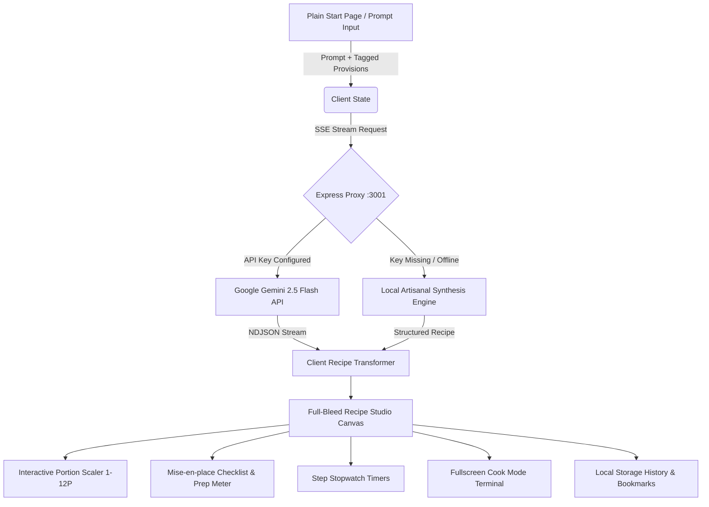

# KITCHEN.OS // Precision Culinary Operating System

<p align="center">
  <strong>An AI-powered, minimalist skeuomorphic precision kitchen operating system engineered for technique-driven culinary formulation.</strong>
</p>

<p align="center">
  
  
  
  
  
  
  
  
</p>

---

## 🖥️ System Interface Overview

<p align="center">
  
</p>
<p align="center">
  <em>KITCHEN.OS in action: Full-bleed recipe studio canvas with interactive mise-en-place checklist, digital step timers, and real-time portion scaling.</em>
</p>

---

## 🍽️ Sample Culinary Formulations

| Pan-Seared Chilean Sea Bass | Wild Forest Mushroom Risotto | Artisanal Provision Flatlay |
| :---: | :---: | :---: |
|  |  |  |
| *Saffron Emulsion & Charred Asparagus* | *Aged Parmigiano-Reggiano & Porcini Broth* | *Mise-en-place & Provision Extraction* |

---

## ⚡ Core Philosophy & Highlights

**KITCHEN.OS** transforms raw pantry provisions into technique-driven culinary masterworks. Built with a signature plain, conversational start page inspired by modern AI interfaces (Gemini, Claude, ChatGPT) and paired with Dieter Rams / Teenage Engineering minimalist skeuomorphism, the application provides an effortless prompt-first experience that seamlessly expands into a full-bleed precision kitchen terminal.

### Key Architectural Features

- **Plain Conversational Start Page (Gemini / Claude / ChatGPT style)**: Fresh sessions launch on a spacious, centered start page with a friendly greeting (*"What are we cooking today?"*), a floating prompt console, quick-tag provisions tray, and benchmark suggestion cards.
- **Full-Bleed Recipe Studio Canvas**: Wide-format workspace with zero wasted margins, technical specifications banner, and real-time refinement prompt bar.
- **Minimalist Skeuomorphic Architecture**: Tactile extruded buttons (`skeuo-btn`), debossed inset wells (`skeuo-inset`), status LEDs, and **JetBrains Mono** LCD readouts.
- **Dual-Layer Mechanical Sound Synthesizer**: Procedural Web Audio API engine delivering authentic tactile switch clicks (high-frequency leaf snap + low-frequency keycap bottom-out thud) with zero external audio assets.
- **Dynamic Portion Dial**: Real-time mathematical recalculation of ingredient quantities, units, and caloric metrics across 1 to 12 servings.
- **Zero-Overlap Mise-en-place**: Checked provisions with real-time prep meters, smart substitutions, and responsive text wrapping.
- **Fullscreen Cook Mode Terminal**: Hands-free kitchen companion featuring digital countdown timers, resonant audio bell chimes, and browser text-to-speech voice guidance.
- **Persistent Recipe Storage & History**: Automatic local storage log preserving past formulations in browser memory with search, quick-load, and bookmarking.
- **Cellar Sommelier Pairing**: Alcoholic fine wine vintages paired alongside artisanal non-alcoholic zero-proof botanical alternatives.
- **Dual AI Engine**: Live streaming via Google Gemini API (`gemini-2.5-flash` / `gemini-1.5-flash`) with automatic fallback to local artisanal synthesis for seamless offline operation.

---

## 🖥️ System Architecture & Data Flow



---

## 🚀 Quick Start & Setup

### Prerequisites
- **Node.js** (v18.x or higher)
- **npm** (v9.x or higher)
- Optional: **Google Gemini API Key** (from [Google AI Studio](https://aistudio.google.com/))

### 1. Repository Installation
```bash
# Clone the repository
git clone https://github.com/Dhuvie/recipe-ai.git
cd recipe-ai

# Install server and client dependencies
npm run install:all
```

### 2. Backend Server Configuration
```bash
cd server

# Copy environment template
cp .env.example .env

# Configure your Gemini API key in .env (Optional: local artisanal synthesis works offline)
# GEMINI_API_KEY=AIzaSy...
# PORT=3001

# Launch backend server
node index.js
```

### 3. Frontend Development Server
In a separate terminal:
```bash
cd client

# Launch Vite development server
npm run dev
```

Navigate to `http://localhost:5173` in your browser.

### 4. Deploying to Vercel
1. Push your repository to GitHub.
2. Import the repository in [Vercel](https://vercel.com/new).
3. (Optional) In Vercel Project Settings > **Environment Variables**, add:
   * `GEMINI_API_KEY`: Your Google Gemini API key.
4. Click **Deploy**. Vercel will automatically build and route both the `client` (Vite) and `server` (Express) services defined in [`vercel.json`](./vercel.json).

---

## 🎛️ User Interface Guide

### 1. Plain Conversational Start Page (Gemini / Claude / ChatGPT Style)
- **Central Greeting**: Clean, spacious start screen asking *"What are we cooking today?"*
- **Floating Interactive Prompt Box**: Auto-focus textarea with `Enter` key execution and inline tagged ingredient badges.
- **Quick-Tag Provisions Tray (`[+ Provisions]`)**: Inline collapsible rack to easily tap and attach proteins, produce, dairy, grains, and aromatics directly into your prompt.
- **Directives Tuning (`[Preferences]`)**: One-click cycling for Dietary Disciplines (Omnivore, Keto, Plant-Based, Gluten-Free), Preparation Windows (15m, 30m, 45m+), and Heat Levels.
- **Recent Formulations Log**: Instant quick-launch cards for recently formulated dishes saved in local storage.
- **Benchmark Inspiration Cards**: 4 signature cards (Chilean Sea Bass, Truffle Risotto, Ribeye Steak, Burrata Tartare) and a *Surprise Me* randomizer.

### 2. Full-Bleed Recipe Studio Canvas (Active Formulation View)
- **Cuisine & Timing Matrix**: Classified difficulty, preparation and cooking times, and caloric energy readouts.
- **Portion Dial (`[-] 2P [+]`)**: Instant mathematical recalculation of ingredient quantities across 1 to 12 servings.
- **Mise-en-place Checklist**: Interactive preparation checklist with real-time completion progress meters and smart substitutions.
- **Step Stopwatch Timers**: In-line digital countdown timers for precise technique execution.
- **Fullscreen Cook Mode (`[ COOK MODE ]`)**: Kitchen companion featuring countdown timers, completion audio bell chimes, and speech synthesis voice guidance.
- **Cellar Sommelier Matrix**: Dedicated alcoholic wine pairing and non-alcoholic botanical pairing notes.
- **Refinement Bar**: Conversational bottom bar to adjust or ask questions about the current formulation.
- **Return to Start (`[+ New Recipe]`)**: Instantly resets back to the clean plain start page.

### 3. Recipe Storage & Memory Drawer (`[ Storage ]`)
- **Past Formulations Tab**: Chronological history of all generated recipes with search, one-click loading, and deletion.
- **Bookmarks Tab**: Curated repository of favorited recipes.
- **Clear Log**: One-click wipe to reset recipe history anytime.

### 4. Optional Hardware Pantry Console
- Toggled via the **Pantry Console** button in the header when in recipe mode to access the complete categorized tactile hardware keyboard.

---

## ⌨️ Keyboard Shortcuts (Cook Mode Terminal)

| Shortcut | Action |
| :--- | :--- |
| <kbd>→</kbd> | Next Step |
| <kbd>←</kbd> | Previous Step |
| <kbd>Space</kbd> | Start / Pause Active Step Timer |
| <kbd>Esc</kbd> | Exit Cook Mode Terminal |

---

## 🛠️ Technology Stack

- **Frontend Core**: React 19, TypeScript, Vite
- **Styling**: Tailwind CSS + Custom Tactile Skeuomorphic Tokens (`skeuo-raised`, `skeuo-inset`, `skeuo-btn`, `skeuo-led`)
- **Typography**: Inter (UI) & JetBrains Mono (LCD Metrics)
- **Audio Synthesis**: Native Web Audio API (Dual-layer procedural switch sound synthesizer)
- **Speech Synthesis**: Native Web Speech API (`window.speechSynthesis`)
- **Backend Proxy**: Express 5, CORS, Dotenv, Server-Sent Events (SSE)
- **AI Model**: Google Gemini 2.5 Flash / Gemini 1.5 Flash via `@google/generative-ai`

---

## 📄 License

ISC License © 2026 Dhuvie. Engineered for culinary precision.
